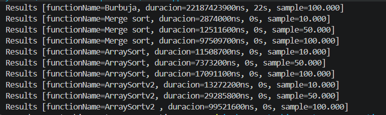

# Practica de Laboratorio PL1.1: Comparativa de metodos de ordenamiento y benchmaking

* **Autor:** Erick Fernando Solis Campoverde
* **Carrera:** Computacion - Universidad Politecnica Salesiana
* **Asignatura:** Estructura de Datos
* **Version del JDK:** OpenJDK 17.0.12 *



## Estructura del Proyecto y Responsabilidades

```text
proyecto-benchmark/
├── README.md
├── INVESTIGACION.md
├── evidencias/
│   ├── captura_consola.png
│   └── pruebas.md
└── src/
    ├── App.java
    ├── Generador.java
    ├── Benchmark.java
    ├── Results.java
    ├── Metodos.java
    └── Validador.java

Generador.java: Genera las muestras base int[] (list1, list2, list3) de tamaño $n$ con valores aleatorios en $[0, n]$ inclusive[cite: 1].
Metodos.java: Implementa los cuatro algoritmos (sortBubble para Burbuja optimizado, metodo2 para Merge Sort, metodo3 para Arrays.sort(int[]) y metodo4 para Arrays.sort(Integer[], Comparator))[cite: 1, 2].
Benchmark.java: Clase reutilizable que recibe una operación Runnable, el nombre del método y el sample, mide la duración con System.nanoTime() y retorna un objeto Results[cite: 1].Results.java: Almacena el nombre del método, sample y la duración en nanosegundos (long), calculando milisegundos mediante duracionNs / 1_000_000.0[cite: 1].
Validador.java: Comprueba fuera del cronómetro que cada salida esté ordenada y conserve todos los elementos, además de ejecutar los casos de aceptación (CA01–CA09)[cite: 1].
App.java: Coordina la generación de las tres listas base, crea clones independientes (.clone()), ejecuta las 12 mediciones, las almacena en List<Results> e imprime la lista completa al finalizar[cite: 1].

Funcionamiento del Benchmarking:

Interfaz funcional y lambdas: Benchmark.medir(Runnable, String, String) recibe la llamada al ordenamiento mediante una lambda (() -> m.metodo2(list1c2)), manteniendo la clase Benchmark independiente de los algoritmos[cite: 1].

Inicio y fin del cronómetro: Se toma System.nanoTime() inmediatamente antes y después de tarea.run(). La diferencia se guarda en nanosegundos (long) y se convierte a milisegundos dividiendo entre 1_000_000.0[cite: 1].

Significado de sample: Representa la cantidad de elementos ordenados (10.000, 50.000 o 100.000)[cite: 1].

Operaciones incluidas y excluidas: El intervalo medido incluye la ejecución del ordenamiento (y la reserva del arreglo auxiliar en metodo2, así como el empaquetado a Integer[] dentro de metodo4 al recibir int[]). La generación de list1..list3, los .clone(), las validaciones y la impresión final ocurren fuera del cronómetro[cite: 1].

Tratamiento de errores: Si la operación lanza una excepción, Benchmark.medir no la captura ni registra tiempo 0; deja que se propague con su causa original[cite: 1].

Resultados Obtenidos:

| Método | Sample | Tiempo en milisegundos |
| :--- | :---: | :---: |
| Burbuja (optimizado con corte temprano) | 10.000 | 102.7886 |
| Merge sort | 10.000 | 3.7146 |
| Arrays.sort · int[] | 10.000 | 15.4036 |
| Arrays.sort + Comparator · Integer[] | 10.000 | 19.9061 |
| Burbuja (optimizado con corte temprano) | 50.000 | 5149.0091 |
| Merge sort | 50.000 | 14.3744 |
| Arrays.sort · int[] | 50.000 | 9.4160 |
| Arrays.sort + Comparator · Integer[] | 50.000 | 36.8916 |
| Burbuja (optimizado con corte temprano) | 100.000 | 23227.7078 |
| Merge sort | 100.000 | 98.1595 |
| Arrays.sort · int[] | 100.000 | 21.5802 |
| Arrays.sort + Comparator · Integer[] | 100.000 | 125.7363 |

Se generaron tres muestras base (10.000, 50.000 y 100.000) y se ejecutaron en orden Burbuja, Merge sort, ArraySort y ArraySortv2 sobre clones independientes, guardando los 12 objetos Results en List<Results> e imprimiéndolos al final

Conclusiones:

1.Al aumentar el tamaño de la muestra de 10.000 a 100.000 elementos se evidenció de forma práctica la diferencia entre un algoritmo cuadrático y uno O(nlog⁡n)O(n \log n)O(nlogn).Burbuja pasó de 102.78 ms en 10.000 elementos a 5.149,00 ms en 50.000 y a 23.227,70 ms en 100.000. Es decir, al multiplicar por 10 el tamaño de los datos, el tiempo se multiplicó por aproximadamente 226 veces. Esto confirma su comportamiento cuadrático: aunque implementa un corte temprano cuando no hay intercambios, ese corte no ayuda cuando los datos están desordenados, porque en cada pasada debe seguir comparando casi todos los elementos.Merge Sort, en cambio, pasó de 3.71 ms a 14.37 ms y a 98.15 ms en los mismos tamaños. Al multiplicar por 10 el tamaño, el tiempo solo se multiplicó por 26 veces. Esto se debe a su estrategia recursiva de dividir el problema en mitades y utilizar un arreglo auxiliar para mezclar de forma ordenada, lo que reduce drásticamente la cantidad de comparaciones.En la práctica, en 100.000 elementos Burbuja fue aproximadamente 236 veces más lento que Merge Sort (23.227 ms frente a 98 ms). Por eso, aunque Burbuja es más sencillo de implementar, para conjuntos grandes no es viable, y la decisión de implementar Merge Sort se justifica porque mantiene un crecimiento controlado y un rendimiento estable aunque aumente el tamaño de la muestra.

2. En 100.000 elementos se observó una diferencia clara entre las dos formas de usar Arrays.sort: ArraySort sobre int[] tardó 21.58 ms, mientras que ArraySortv2 sobre Integer[] con Comparator tardó 125.73 ms, es decir, aproximadamente 5.8 veces más lento.Esta diferencia no se debe a que el algoritmo sea distinto, sino a lo que hay detrás de cada tipo de dato. Al ordenar int[], Java trabaja directamente con tipos primitivos en memoria contigua, sin crear objetos, y utiliza Dual-Pivot Quicksort, que está altamente optimizado para primitivos y hace comparaciones directas con < y >.En cambio, al ordenar Integer[], cada número es un objeto en el Heap, lo que implica mayor uso de memoria, peor uso de la caché y la necesidad de desempaquetar (unboxing) el valor en cada comparación. Además, al usar Comparator<Integer> se añade una llamada a un método por cada comparación, en lugar de una comparación directa, lo que aumenta el costo por operación.Otro factor importante es lo que quedó incluido dentro de la lambda en Benchmark.medir: en el caso de v2 no solo se mide el ordenamiento, sino también el trabajo previo de convertir el arreglo de int a Integer y la creación y uso del Comparator. Por eso el tiempo medido es mayor, aunque el ordenamiento en sí sea similar.En conclusión, para rendimiento puro es preferible trabajar con primitivos int[], mientras que Integer[] + Comparator se justifica solo cuando se necesita flexibilidad, como ordenar objetos, ordenar de forma descendente o con un criterio personalizado, aceptando el costo extra que eso implica.

3. Un punto clave del experimento fue que cada variante recibió su propio clon (list1c1 ... list3c4) a partir de las tres muestras base (list1, list2, list3). Esto fue fundamental para que la comparativa sea válida, porque si todos los métodos hubieran ordenado el mismo arreglo, el primer método lo habría dejado ordenado y los siguientes habrían medido el tiempo de ordenar un arreglo ya ordenado, y no un arreglo desordenado. Al clonar antes de medir, se aseguró que cada algoritmo partiera exactamente de las mismas condiciones iniciales.Sin embargo, la medición también tiene limitaciones que deben considerarse. Cada algoritmo se midió una sola vez por tamaño con System.nanoTime() mediante Benchmark.medir usando lambdas. Una sola corrida no es suficiente para obtener un resultado totalmente estable, porque el tiempo puede verse afectado por factores externos.Entre esos factores está el comportamiento de la JVM, que en las primeras ejecuciones todavía está cargando clases, interpretando código y activando el compilador JIT, por lo que los primeros métodos medidos pueden salir más lentos. También influye el estado del equipo durante la prueba, como otros procesos en segundo plano, el uso de CPU o la memoria disponible, que pueden generar variaciones de algunos milisegundos entre corridas.Por eso, aunque los resultados obtenidos muestran claramente la tendencia general —Burbuja crece mucho más rápido que Merge Sort y int[] es más eficiente que Integer[]—, para una medición más precisa sería necesario realizar varias repeticiones por cada tamaño, descartar la primera corrida de calentamiento y calcular un promedio. La clonación garantizó la equidad del experimento, pero la repetición garantizaría la estabilidad de los tiempos.

