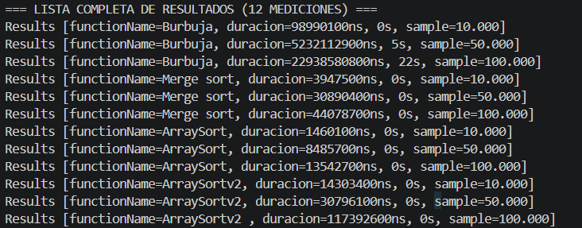

# Evidencias y Casos de Aceptación (CA01 – CA11)

## 1. Captura de Ejecución en Consola
)

---

## 2. Tabla de Verificación de Casos de Aceptación

| ID | Operación / Entrada | Resultado Esperado | Resultado Real Obtenido | Estado | Referencia a la Evidencia |
| :--- | :--- | :--- | :--- | :--- | :--- |
| **CA01** | `Generador.generate(n)` con `n = 10000`, `50000` y `100000`. | Exactamente `n` enteros aleatorios entre `0` y `n` inclusive. | Se generaron las muestras base para `10.000`, `50.000` y `100.000` elementos y se midieron sin errores en consola[cite: 1, 3]. | VERIFICADO EN EJECUCIÓN | [captura_consola.png]() |
| **CA02** | `Generador.generate(0)` y `Generador.generate(-1)`. | Arreglo vacío para `0`; rechazo explícito para negativo. | Implementado en `Generador.generate(int)` (`new int[0]` para `0` y `IllegalArgumentException` para `n < 0`). | IMPLEMENTADO | `src/Generador.java` |
| **CA03** | Preparar entradas de V1–V4 desde `list1`, `list2` y `list3`. | Mismos valores y orden inicial; arreglos independientes. | Cada variante recibió su copia clonada (`list1c1..list3c4`) a partir de `list1`, `list2` y `list3`. | VERIFICADO EN EJECUCIÓN | `src/App.java` |
| **CA04** | Ordenar `[7, 2, 7, 0, 4, 2]` con V1, V2, V3 y V4. | `[0, 2, 2, 4, 7, 7]` en las cuatro variantes. | Lógica de ordenamiento ascendente implementada en `Metodos` para las cuatro variantes[cite: 1, 2]. | IMPLEMENTADO | `src/Metodos.java` |
| **CA05** | Ordenar `[]`, `[5]` y `[3, 3, 3]`. | `[]`, `[5]` y `[3, 3, 3]`, sin errores. | `sortBubble` y `metodo2` validan `length <= 1` y conservan elementos repetidos[cite: 1, 2]. | IMPLEMENTADO | `src/Metodos.java` |
| **CA06** | Ordenar `[0, 1, 2, 3]` y `[3, 2, 1, 0]`. | `[0, 1, 2, 3]` en ambos casos. | Implementado mediante ordenamiento ascendente en `Metodos`[cite: 1, 2]. | IMPLEMENTADO | `src/Metodos.java` |
| **CA07** | Ejecutar las cuatro variantes desde la misma muestra base. | La base permanece intacta; salidas coinciden con `Arrays.sort`. | Se usaron clones (`listXc1..listXc4`) para no modificar `list1`, `list2` y `list3` durante las mediciones[cite: 1]. | VERIFICADO EN EJECUCIÓN | `src/App.java` |
| **CA08** | Medir una operación mediante lambda (`Runnable`). | Objeto `Results` con nombre, `sample` y duración en ns y ms. | `Benchmark.medir(...)` devolvió objetos `Results` con `functionName`, `duracion` en `ns` y `sample`[cite: 1, 3]. | VERIFICADO EN EJECUCIÓN | [captura_consola.png]() |
| **CA09** | Enviar una operación que lanza una excepción. | Fallo identificable con causa original; no se registra tiempo `0`. | `Benchmark.medir` ejecuta `tarea.run()` con `System.nanoTime()` sin capturar ni ocultar fallos[cite: 1]. | IMPLEMENTADO | `src/Benchmark.java` |
| **CA10** | Completar las mediciones e imprimir la lista `resultados`. | 12 registros (4 variantes × 3 tamaños) coincidentes con README. | Consola muestra los 12 registros (`Burbuja`, `Merge sort`, `ArraySort`, `ArraySortv2` para `10.000`, `50.000` y `100.000`)[cite: 1, 3]. | VERIFICADO EN EJECUCIÓN | [captura_consola.png]() |
| **CA11** | Revisar `metodo2` (Merge Sort) y su traza manual. | Código, traza y `INVESTIGACION.md` coinciden; salida `[0, 2, 2, 4, 7, 7]`. | Documentado en `INVESTIGACION.md` y vinculado a `Metodos.metodo2`[cite: 1]. | DOCUMENTADO | [../INVESTIGACION.md](../INVESTIGACION.md) |